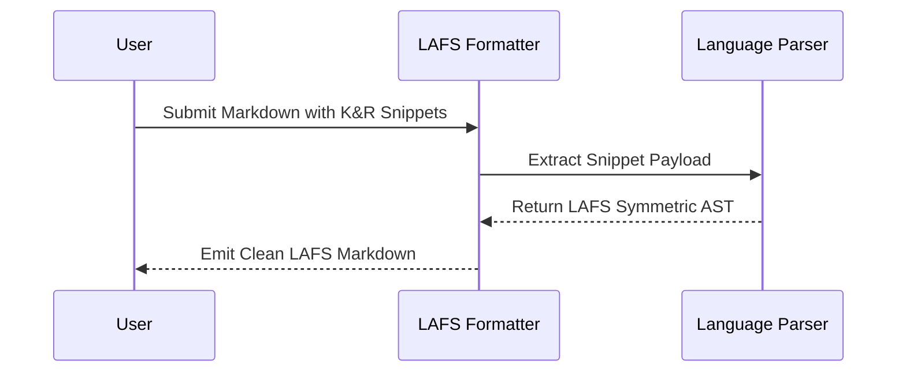

# Universal Language-Agnostic Formatting Style (LAFS) Markdown Verification Suite

This document serves as an exhaustive, battle-hardened torture test for validating LAFS formatting of embedded multi-language code snippets within Markdown files. It rigorously exercises fence boundary parsing, blockquote prefixing, list-item indentation preservation, language-specific AST/CST formatters, and non-code fence immutability. Under LAFS Rules 28 and 29, all prose paragraphs in this document flow continuously as unbroken semantic units without any artificial eighty-column line wrapping, allowing viewports to soft-wrap naturally.

| Language | Target Formatter | Context / Structure | Expected Delimiter Behavior |
| :--- | :--- | :--- | :--- |
| **Rust** | Core LAFS Engine (`RUST_PROFILE`) | Structs, enums, pattern matching, closures | Detached Allman braces, vertical symmetry |
| **TypeScript / TSX** | `JS_TS_Formatter` | Generic arrows, multiline JSX, render props | Column-Anchored Hybrid `return (`, attribute `=` alignment |
| **Dart** | `Dart_Formatter` | Cascades, constructor bodies, collections | Detached braces, pure vertical load-paths |
| **Go** | `Go_Formatter` | Goroutines, select blocks, multiple returns | Column-Anchored Hybrid `func () {` when enabled |
| **Kotlin** | `Kotlin_Formatter` | Data classes, when statements, trailing lambdas | Allman detached braces (v1) / Official CAH (v2) |
| **C++** | Core LAFS Engine (`CPP_PROFILE`) | Templates, class definitions, method bodies | Symmetric detached braces |
| **Shell** | `Shell_Formatter` | Functions, condition blocks, subshells | Detached function braces, preserved tests |
| **JSON & TOML** | Generic & TOML Formatters | Manifests, nested objects, arrays | Pure Allman detached braces / Monolith |
| **Text & Mermaid** | Verbatim Preservation Gate | Preformatted text diagrams, sequence charts | 100% bit-for-bit unchanged |

---

## 1. Rust Systems Engine (Top-Level Code Block)

The following snippet implements a multi-producer asynchronous buffer manager written with classic K&R trailing delimiters and compact control-flow statements.

```rust
use std::collections::VecDeque;
use std::sync::{Arc, Mutex, Condvar};
use std::time::{Duration, Instant};

pub enum BufferStatus {
    Ready(usize),
    Pending { queue_depth: usize, estimated_ms: u64 },
    Exhausted,
}

pub struct RingBuffer<T> {
    storage: VecDeque<T>,
    capacity: usize,
    lock: Mutex<usize>,
    notifier: Condvar,
}

impl<T: Clone + Send + 'static> RingBuffer<T> {
    pub fn new(capacity: usize) -> Self {
        RingBuffer {
            storage: VecDeque::with_capacity(capacity),
            capacity,
            lock: Mutex::new(0),
            notifier: Condvar::new(),
        }
    }

    pub fn push(&mut self, item: T) -> Result<(), &'static str> {
        if self.storage.len() >= self.capacity {
            return Err("Capacity overflow encountered");
        }
        self.storage.push_back(item);
        Ok(())
    }

    pub fn process_batch<F>(&mut self, mut handler: F) -> usize where F: FnMut(&T) -> bool {
        let mut processed = 0;
        for item in &self.storage {
            if handler(item) {
                processed += 1;
            } else {
                break;
            }
        }
        processed
    }

    pub fn inspect(&self) -> BufferStatus {
        match self.storage.len() {
            0 => BufferStatus::Exhausted,
            len if len < self.capacity => {
                BufferStatus::Pending {
                    queue_depth: len,
                    estimated_ms: (len as u64) * 12,
                }
            }
            len => BufferStatus::Ready(len),
        }
    }
}
```

---

## 2. TypeScript & TSX Reactive Component (With Multiline JSX)

This section exercises the TypeScript and TSX formatting subsystem. It contains generic type parameters, Column-Anchored Hybrid `return (` statements, multiline JSX attributes, and arrow functions with trailing K&R braces.

```tsx
import React, { useState, useEffect, useMemo, useCallback } from 'react';

export interface TelemetryRecord {
    readonly id: string;
    readonly label: string;
    readonly latencyMs: number;
    readonly isDegraded: boolean;
    readonly tags: readonly string[];
}

export interface TelemetryGridProps<T extends TelemetryRecord> {
    readonly clusterId: string;
    readonly records: readonly T[];
    readonly refreshIntervalMs?: number;
    readonly onSelectRecord?: (record: T) => void;
    readonly renderBadge?: (record: T) => React.ReactNode;
}

export const TelemetryGrid = <T extends TelemetryRecord>(props: TelemetryGridProps<T>): React.ReactElement => {
    const [selectedId, setSelectedId] = useState<string | null>(null);
    const [sortAscending, setSortAscending] = useState<boolean>(true);

    const sortedRecords = useMemo(() => {
        return [...props.records].sort((a, b) => {
            if (sortAscending) {
                return a.latencyMs - b.latencyMs;
            } else {
                return b.latencyMs - a.latencyMs;
            }
        });
    }, [props.records, sortAscending]);

    const handleSelect = useCallback((item: T) => {
        setSelectedId(item.id);
        if (props.onSelectRecord) {
            props.onSelectRecord(item);
        }
    }, [props.onSelectRecord]);

    return (
        <section
            className="TelemetryGridContainer"
            data-cluster-id={props.clusterId}
            data-record-count={props.records.length}>
            <header className="TelemetryGridHeader">
                <h2>Cluster Telemetry: {props.clusterId}</h2>
                <button
                    type="button"
                    className="SortToggleBtn"
                    onClick={() => { setSortAscending(!sortAscending); }}>
                    Toggle Direction ({sortAscending ? 'ASC' : 'DESC'})
                </button>
            </header>
            <div className="TelemetryCardList">
                {sortedRecords.map((item, index) => {
                    const isSelected = item.id === selectedId;
                    return (
                        <article
                            key={item.id}
                            className={`RecordCard ${isSelected ? 'selected' : ''}`}
                            data-index={index}
                            data-latency={item.latencyMs}
                            onClick={() => { handleSelect(item); }}>
                            <span className="RecordTitle">{item.label}</span>
                            <span className="RecordLatency">{item.latencyMs}ms</span>
                            {props.renderBadge ? props.renderBadge(item) : (
                                <span className={`StatusPill ${item.isDegraded ? 'crit' : 'ok'}`}>
                                    {item.isDegraded ? 'WARN' : 'NOMINAL'}
                                </span>
                            )}
                        </article>
                    );
                })}
            </div>
        </section>
    );
};
```

---

## 3. Dart Reactive State Service

Here is an enterprise Dart 3 class featuring constructor initializer lists, cascade operators (`..`), collection `if` statements, and K&R hugged delimiters.

```dart
import 'dart:async';
import 'dart:collection';

enum ConnectionState { disconnected, connecting, connected, faulted }

class TelemetryPacket {
    final String packetId;
    final double metricValue;
    final DateTime recordedAt;

    const TelemetryPacket({
        required this.packetId,
        required this.metricValue,
        required this.recordedAt,
    });
}

class TelemetryOrchestrator {
    final String gatewayUrl;
    final Duration timeoutDuration;
    final StreamController<TelemetryPacket> _packetStream;
    ConnectionState _currentState = ConnectionState.disconnected;

    TelemetryOrchestrator({
        required this.gatewayUrl,
        this.timeoutDuration = const Duration(seconds: 15),
    }) : _packetStream = StreamController<TelemetryPacket>.broadcast();

    Stream<TelemetryPacket> get packets => _packetStream.stream;
    ConnectionState get state => _currentState;

    Future<void> initializeConnection() async {
        if (_currentState == ConnectionState.connected) {
            return;
        }

        _currentState = ConnectionState.connecting;
        try {
            await Future.delayed(const Duration(milliseconds: 250));
            _currentState = ConnectionState.connected;
            _scheduleHeartbeat();
        } catch (error) {
            _currentState = ConnectionState.faulted;
            rethrow;
        }
    }

    void dispatchPacket(String id, double value) {
        if (_currentState != ConnectionState.connected) {
            throw StateError('Cannot dispatch packet when orchestrator is disconnected');
        }

        final packet = TelemetryPacket(
            packetId: id,
            metricValue: value,
            recordedAt: DateTime.now(),
        );

        _packetStream.add(packet);
    }

    void _scheduleHeartbeat() {
        Timer.periodic(const Duration(seconds: 5), (timer) {
            if (_currentState != ConnectionState.connected) {
                timer.cancel();
            } else {
                dispatchPacket('heartbeat', 1.0);
            }
        });
    }

    void dispose() {
        _packetStream.close();
        _currentState = ConnectionState.disconnected;
    }
}
```

---

## 4. Go Concurrency Pipeline

This Go snippet models worker pool orchestration with channels, select statements, and struct methods.

```go
package pipeline

import (
    "context"
    "errors"
    "sync"
    "time"
)

type Job struct {
    ID       string
    Payload  []byte
    Attempts int
}

type Result struct {
    JobID     string
    Output    string
    Error     error
    Duration  time.Duration
}

type WorkerPool struct {
    concurrency int
    jobsChan    chan Job
    resultsChan chan Result
    wg          sync.WaitGroup
}

func NewWorkerPool(concurrency int, queueCap int) *WorkerPool {
    return &WorkerPool{
        concurrency: concurrency,
        jobsChan:    make(chan Job, queueCap),
        resultsChan: make(chan Result, queueCap),
    }
}

func (wp *WorkerPool) Start(ctx context.Context) {
    for i := 0; i < wp.concurrency; i++ {
        wp.wg.Add(1)
        go wp.workerLoop(ctx, i)
    }
}

func (wp *WorkerPool) workerLoop(ctx context.Context, workerID int) {
    defer wp.wg.Done()
    for {
        select {
        case <-ctx.Done():
            return
        case job, ok := <-wp.jobsChan:
            if !ok {
                return
            }
            start := time.Now()
            out, err := wp.process(job)
            wp.resultsChan <- Result{
                JobID:    job.ID,
                Output:   out,
                Error:    err,
                Duration: time.Since(start),
            }
        }
    }
}

func (wp *WorkerPool) process(j Job) (string, error) {
    if len(j.Payload) == 0 {
        return "", errors.New("empty payload")
    }
    return "PROCESSED: " + j.ID, nil
}
```

---

## 5. Kotlin Multiplatform ViewModel

The following Kotlin code includes data classes, when expressions with branch logic, and trailing lambdas.

```kotlin
package com.lafs.telemetry

import kotlinx.coroutines.flow.MutableStateFlow
import kotlinx.coroutines.flow.StateFlow
import kotlinx.coroutines.flow.asStateFlow

sealed interface DeviceState {
    data object Idle : DeviceState
    data class Calibrating(val progressPercent: Int) : DeviceState
    data class Operational(val activeChannels: List<String>) : DeviceState
    data class Error(val reason: String, val recoveryCode: Int) : DeviceState
}

data class TelemetrySnapshot(
    val deviceId: String,
    val timestampUtc: Long,
    val state: DeviceState
)

class DeviceController(private val deviceId: String) {
    private val _stateFlow = MutableStateFlow<DeviceState>(DeviceState.Idle)
    val stateFlow: StateFlow<DeviceState> = _stateFlow.asStateFlow()

    fun transition(next: DeviceState): Boolean {
        return when (val current = _stateFlow.value) {
            is DeviceState.Idle -> {
                _stateFlow.value = next
                true
            }
            is DeviceState.Calibrating -> {
                if (next is DeviceState.Operational || next is DeviceState.Error) {
                    _stateFlow.value = next
                    true
                } else {
                    false
                }
            }
            is DeviceState.Operational -> {
                _stateFlow.value = next
                true
            }
            is DeviceState.Error -> {
                if (next is DeviceState.Idle) {
                    _stateFlow.value = next
                    true
                } else {
                    false
                }
            }
        }
    }
}
```

---

## 6. Code Snippets Nested Inside Blockquotes

Under LAFS, code blocks located inside Markdown blockquotes (`>`) must have their `>` and leading whitespace prefixes properly decoupled during formatting, and cleanly restored upon emission.

> [!NOTE]
> Here is an embedded TypeScript snippet inside an alert callout:
> ```typescript
> export function ValidateCredentials(apiKey: string, secretHash: string): boolean {
>     if (apiKey.length < 32) {
>         return false;
>     }
>     if (secretHash.length !== 64) {
>         return false;
>     }
>     return true;
> }
> ```
> And here is a Rust error handling routine within the same blockquote:
> ```rust
> pub fn safe_divide(numerator: f64, denominator: f64) -> Result<f64, &'static str> {
>     if denominator.abs() < f64::EPSILON {
>         return Err("Division by zero");
>     }
>     Ok(numerator / denominator)
> }
> ```

---

## 7. Code Snippets Nested Inside Lists

Code fences inside ordered and unordered list items carry indentation whitespace (`  ` or `    `) that must be preserved exactly:

1. First, declare your HTTP server router in JavaScript:
   ```javascript
   const http = require('http');

   const server = http.createServer((req, res) => {
       if (req.url === '/health') {
           res.writeHead(200, { 'Content-Type': 'application/json' });
           res.end(JSON.stringify({ status: 'ok', uptime: process.uptime() }));
       } else {
           res.writeHead(404);
           res.end();
       }
   });
   ```
2. Next, launch the service using a shell wrapper script:
   ```bash
   deploy_cluster() {
       local target_env="${1:-production}"
       if [ -z "$DEPLOY_KEY" ]; then
           echo "Fatal: Missing DEPLOY_KEY environment variable"
           exit 1
       fi
       echo "Initiating rollout to: ${target_env}"
   }
   ```

---

## 8. Non-Code Fences (Preserved Verbatim)

Non-code fences such as `text`, `mermaid`, and `diff` must pass through the formatter completely untouched:

```text
+-----------------------+-----------------------+
|  Column 0 (Baseline)  |  Column 160 (Canvas)  |
|  [OPEN CONTAINER]     |                       |
|      Payload Line 1   |                       |
|      Payload Line 2   |                       |
|  [CLOSE CONTAINER]    |                       |
+-----------------------+-----------------------+
```



```diff
- function OldStyle() {
-     return 42;
- }
+ function NewStyle()
+ {
+     return 42;
+ }
```

---

## 9. Manifests & Data Enclosures (JSON & TOML)

```json
{
  "service": "lafs-telemetry-engine",
  "version": "1.0.0",
  "capabilities": [
    "multi-language",
    "markdown-extraction",
    "pure-allman-symmetry"
  ],
  "runtime": {
    "threads": 16,
    "canvasWidth": 160
  }
}
```

```toml
[package]
name = "lafs-test-suite"
version = "0.1.0"
edition = "2021"

[dependencies]
serde = { version = "1.0", features = ["derive"] }
tokio = { version = "1.40", features = ["full"] }

[features]
default = ["std"]
std = []
```
